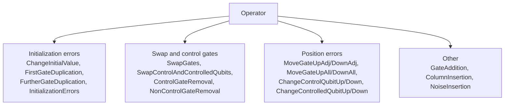

# qumugen — mutant generator

Spring Boot 4.0.2 / Java 21 service that generates mutants of a quantum circuit. Part of [Qumuclient](../../README.md).

## Run

```bash
mvn spring-boot:run     # asks for a port; Enter (or 5 s without input) uses 8500
mvn test
```

## API (`/qumugen`)

| Method | Path | Description |
|---|---|---|
| PUT | `/qumugen/generateQuirkMutants` | Generate mutants of a circuit (streamed, optionally gzip) |
| PUT | `/qumugen/getQiskitCode` | Qiskit code for one circuit |
| PUT | `/qumugen/getMultipleQiskitCode` | Qiskit code for several circuits |
| GET | `/qumugen/getOperatorsByFamily` | Operators grouped by family |
| GET | `/qumugen/getOperators/{family}` | Operators of one family |
| GET | `/qumugen/getGates` | Available gates |
| POST | `/qumugen/buildUnexCurls`, `/qumugen/sendToUnex` | Unex integration helpers |

## Operators

Implemented in `src/main/java/edu/uclm/qumugen/operators/`:



The operator catalogue stored by `reper` is seeded from `Operadores.sql` in the [QSauron](https://github.com/AlarcosQuantumTesting/QSauron) repository.
