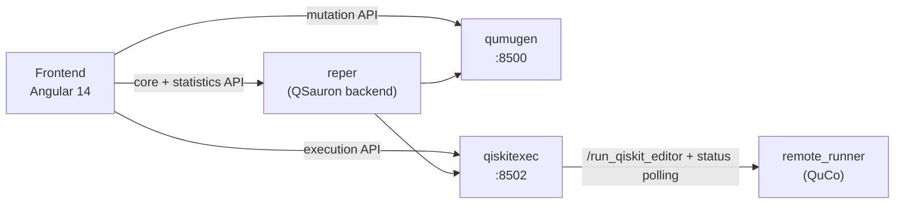
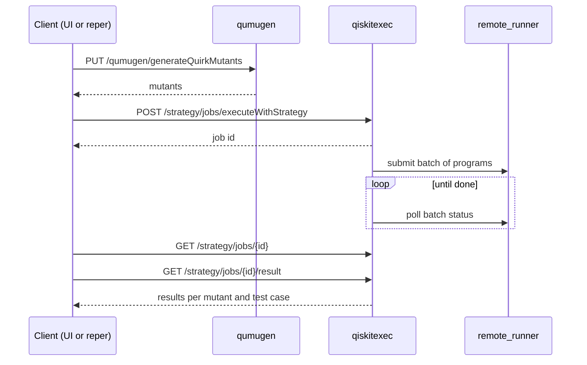
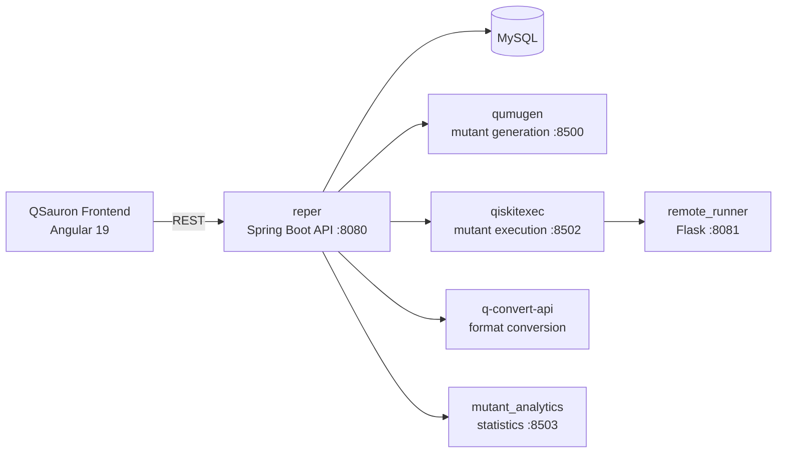

<p align="center">
  
</p>

# Qumuclient

> The mutation-testing workbench for quantum circuits: a web UI plus the services that generate and execute circuit mutants.


## Table of contents

- [Overview](#overview)
- [Modules](#modules)
- [Features](#features)
- [Architecture](#architecture)
- [Getting started](#getting-started)
- [Usage](#usage)
- [Project structure](#project-structure)
- [Testing](#testing)
- [QSauron ecosystem](#qsauron-ecosystem)
- [Roadmap](#roadmap)
- [Contributing](#contributing)
- [License](#license)

## Overview

A quantum circuit that "looks right" can still hide faulty gates. *Mutation testing* injects small, realistic faults into a circuit (wrong initial value, swapped gates, moved controls, noise…) and checks whether your tests notice. Qumuclient bundles everything needed to do that interactively: design circuits, generate their mutants, execute them on simulators and read the results as a killing matrix.

## Modules

| Module | Path | Stack | Default port | Role |
|---|---|---|---|---|
| Frontend | [`Frontend/`](Frontend/README.md) | Angular 14.2 | 4200 (`ng serve`) | Circuit editor, experiment wizard, mutant and results viewers |
| qumugen | [`Backend/qumugen/`](Backend/qumugen/README.md) | Spring Boot 4.0.2, Java 21 | 8500 | Mutant generation from a set of mutation operators |
| qiskitexec | [`Backend/qiskitexec/`](Backend/qiskitexec/README.md) | Spring Boot 4.0.2, Java 21 | 8502 | Execution of circuits and mutants with Qiskit (jobs, strategies) |

Persistence and user management are provided by the separate [`reper`](https://github.com/AlarcosQuantumTesting/QSauron) backend.

## Features

- Visual circuit editing and import.
- 19 mutation operator classes (initialization errors, gate swaps, control/controlled-qubit changes, gate movement and duplication, column insertion, noise insertion, …).
- Pluggable execution strategies (`AllAgainstAll`, `OnlyAlive`) and asynchronous jobs with progress polling.
- Experiment wizard, progress tracker, resume and statistics visualizer.
- Killing matrix with result and test-case filters.
- Shared glassmorphism design system ([style guide](Frontend/GLASSMORPHISM_STYLE_GUIDE.md)).


## Architecture



### From circuit to results



## Getting started

### Prerequisites

- Node.js 16+ and npm (Angular 14)
- Java 21 and Maven 3.9+
- Python with Qiskit for local execution, or a reachable `remote_runner`

### Run the services

```bash
# Mutant generator (asks for a port; press Enter or wait 5 s for 8500)
cd Backend/qumugen
mvn spring-boot:run

# Executor (default port 8502)
cd Backend/qiskitexec
mvn spring-boot:run
```

Executor settings live in `Backend/qiskitexec/src/main/resources/application.properties` (property names: `proxy.url`, `proxy.enabled`, `remote.runner.url`, `execution.*`, `jobs.*`). Keep real URLs and credentials out of git.

### Run the frontend

```bash
cd Frontend
npm install
npm start    # http://localhost:4200
```

Point the UI to your services in `Frontend/src/environments/environment.ts` (`api.core`, `api.mutation`, `api.execution`, `api.statistics`, `loginUrl`).

## Usage

1. Sign in (through the QSauron login) and open or import a circuit.
2. Configure operators and an execution strategy in the experiment wizard.
3. Launch the experiment and follow its progress.
4. Inspect mutants, the killing matrix and statistics.

| Experiment wizard | Mutants view |
|---|---|
|  |  |

## Project structure

```text
Qumuclient/
├── Frontend/            # Angular 14 app
├── Backend/
│   ├── qumugen/         # mutant generation service
│   └── qiskitexec/      # execution service
└── docs/images/         # screenshots (placeholders)
```

## Testing

```bash
cd Frontend && npm test                 # Karma
cd Backend/qumugen && mvn test
cd Backend/qiskitexec && mvn test
```

## QSauron ecosystem



| Repository | Role |
|---|---|
| [QSauron](https://github.com/AlarcosQuantumTesting/QSauron) | `reper` API and persistence |
| [QSauron Frontend](https://github.com/SamRo28/QSauron) | Angular 19 web client |
| [Qumuclient](https://github.com/SamRo28/Qumuclient) | This repository |
| [q-convert-api](https://github.com/SamRo28/q-convert-api) | REST wrapper around the `q-convert` CLI |
| [QuCo `remote_runner`](https://github.com/AlarcosQuantumTesting/QuCo) | Remote execution of Qiskit/Cirq programs |

## Roadmap

- [ ] Container images for the back ends
- [x] Maven project names aligned with the module names
- [ ] Add more mutation operators and strategies
- [ ] Upgrade the Angular front end

## Contributing

See [CONTRIBUTING.md](CONTRIBUTING.md).

## License

[MIT](LICENSE)
